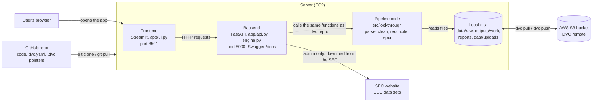
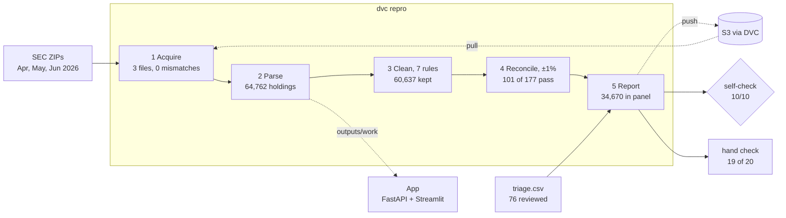

# Project Lantern: Case Study 2B (Team 2)

DAMG 7245, Fall 2026. A reproducible pipeline that turns the SEC's BDC data sets for 2026q2 into one reconciled holdings panel: every holding of every admitted filing, traceable to its filing and SOI rows, reconciled to the BDC's own reported total within 1%, and honest about what it covers.

- **Demo video (maximum 5 minutes):** https://northeastern-my.sharepoint.com/personal/nandavarapu_s_northeastern_edu/_layouts/15/stream.aspx?id=%2Fpersonal%2Fnandavarapu%5Fs%5Fnortheastern%5Fedu%2FDocuments%2FBigdata%5Fteam2%5Ffall26%2FDAMG7245%5FTeam2%5Fcs2b%2Emp4&nav=eyJyZWZlcnJhbEluZm8iOnsicmVmZXJyYWxBcHAiOiJPbmVEcml2ZUZvckJ1c2luZXNzIiwicmVmZXJyYWxBcHBQbGF0Zm9ybSI6IldlYiIsInJlZmVycmFsTW9kZSI6InZpZXciLCJyZWZlcnJhbFZpZXciOiJNeUZpbGVzTGlua0NvcHkifX0&ga=1&referrer=StreamWebApp%2EWeb&referrerScenario=AddressBarCopied%2Eview%2E799d18ef%2Dea04%2D40a2%2D8c77%2D802505b5b9b1
- **Live application:** http://100.49.157.253/
- **Swagger API documentation:** http://100.49.157.253/docs
- **Codelab:** https://docs.google.com/document/d/1GLzlaeA_w7YedAElnZQFLLQcgpPO9HXLntwK72rK4Ck/edit
- **Submission:** tag `cs2b-submission`

**Team:** Sai Guna Vardhan Vudatala (Part 0, Part 4, app), Shravya Ushake (Part 1, Part 5), Dhruvi Mehta (Part 2), Sai Lokesh Reddy Nandavarapu (Part 3).

## Results

- **101 of 177** attempted filings admitted (57.1%), covering **$240.9B of $542.2B** known filed fair value (**44.4%**). A filing is admitted when |our sum − its own filed total| / its filed total ≤ 1%.
- **34,670 holdings** in the panel, with 38,053 SOI source-row references.
- **76 excluded filings**, each with reviewed exclusion evidence: 8 `no_filed_total`, 3 `no_identified_holdings`, 1 `unfunded_commitments`, 1 `restated_copies` (TCW), 63 `other` (discrepancy verified, cause unresolved, kept excluded).
- **19 of 20** sampled holdings match the filings by hand (Part 4).
- **58/58 tests** and **10/10 self-checks** pass.

## Architecture

What the system is made of, and where each part runs.



## Pipeline

What happens to the data, step by step, with the numbers for 2026q2.



## Reproduce from a fresh clone

```bash
git clone https://github.com/BigDataIA-Fall-26-Team-2/DAMG-7245-Project-Lantern-Case-Study-2B-Team-2.git
cd DAMG-7245-Project-Lantern-Case-Study-2B-Team-2
git checkout cs2b-submission
cd cs2b
python -m venv .venv && source .venv/bin/activate      # Python 3.10 or later
pip install -r requirements.txt
AWS_PROFILE=lantern dvc pull
dvc repro
dvc metrics show
python tests/run_tests.py
PYTHONPATH=src python -m lookthrough.check
```

The DVC bucket is private, so `dvc pull` needs an authorized AWS identity: `AWS_PROFILE=<profile> dvc pull`, or `dvc remote modify --local storage profile <name>` once. The TA accepted demonstrating the reproduction from the team's configured environment. The committed configuration uses real data (`data.use_fixture: false`) for the three assigned monthly releases; the bundled synthetic fixture is only for tests.

## Run the app

```bash
cd cs2b
uvicorn app.api:app --port 8000      # backend, Swagger at http://127.0.0.1:8000/docs
streamlit run app/ui.py              # frontend, second terminal
```

"How it's built" walks through the pipeline step by step, with the cleaning rules and tolerance as settings. "Explore the loans" searches one company across every fund and shows every fund report with its triage reason. Runs happen in memory and never write to `outputs/` or `reports/`. Shared-data changes (upload, fetch, delete, refresh) are disabled unless `LANTERN_ADMIN_TOKEN` is configured, and then need an administrator API key. Details in `app/README.md`.

## Deliverables by Part

- **Part 0, acquisition and provenance:** `params.yaml`, `data/manifest.json`, `data/raw.dvc`, `tools/download_release.py`, `scripts/acquire.py`
- **Part 1, parsing and schema:** `docs/schema.md`, `reports/agreement.md`, `reports/period_split.csv`
- **Part 2, cleaning:** rules in `src/lookthrough/clean.py`, `reports/cleaning_log.csv`, `docs/cleaning_log.md`, tests in `tests/`
- **Part 3, reconciliation and coverage:** `outputs/panel/holdings.parquet` (DVC), `reports/coverage.csv`, `reports/coverage.md`, `reports/coverage.json`, `reports/triage.md`, input `data/triage.csv`, audit `reports/triage_review_audit.csv`
- **Part 4, dependency check:** `reports/spot_check.csv`, `reports/dependency_check.md`, sampler `scripts/spot_check_sample.py`
- **Part 5, pipeline and economics:** `dvc.yaml`, `dvc.lock`, `scripts/`, `reports/tests_that_fail.md`, `reports/economics.md`
- **AI engineering logs:** `docs/ai_engineering_log_*.md`

## Known limitations

- Principal is stored without its currency (some loans are in GBP or EUR), and some filers tag equity unit counts as principal, so prices computed from principal are not reliable. The app withholds prices and debt-share estimates for this reason. Fair values are not affected.
- 63 excluded filings keep the category `other`: the discrepancy is verified, the underlying cause is not proven.
- The bucket is private: a clone needs authorized AWS credentials to pull the data.

---

# Technical notes

## Checks
```
python tests/run_tests.py                 # or: pytest -q
python tools/run_notebooks.py             # runs notebooks in an isolated temporary copy (retained for inspection)
PYTHONPATH=src python -m lookthrough.check   # Case Study 2B self-check on your outputs
python tools/smoke_real.py <release> "Name email"   # baseline on any real release (needs network)
```

## Layout
`src/lookthrough/` helpers (paths, acquire, load, mapping, holdings, clean, reconcile, pipeline, report, tables, check);
`data/fixture/` the synthetic release (rebuild with `python tools/make_fixture.py`); `data/raw/` the three releases (DVC, never Git);
`outputs/panel/` the reconciled panel; `reports/` coverage, triage, cleaning log, spot checks; `docs/` schema and pipeline notes; `app/` the FastAPI backend and Streamlit frontend.

## Teaching notebooks
| Notebook | Step |
|---|---|
| 00_setup | Environment, parameters, tests |
| 01_primer_exercise | One holding, from flat file to filing |
| 02_acquire | Download your release, manifest, DVC (switches you to real data) |
| 03_raw_parse | SUB, TAG, NUM and SOI; map columns by tag |
| 04_periods_and_dimensions | Dates, current vs comparative schedules, segments, coalescing |
| 05_clean | Find artifacts, write rules, keep a cleaning log |
| 06_reconcile | Reconcile to filed totals, coverage, triage, outputs, self-check |
| 07_verify_dependency | Spot-check against the filings; optional EdgarTools comparison |
| 08_pipeline_and_economics | Tests that fail, timing, unit economics, DVC pipeline |

The notebooks are the starter kit's single-release demonstrations, not submission outputs. Use `dvc repro` for the multi-release pipeline.

## Configured input scope and Part 3 baseline

From `cs2b`, restore the versioned inputs and run the baseline:

```bash
AWS_PROFILE=lantern dvc pull
python tools/baseline.py
```

`paths.release_dirs` resolves the scope for the configured baseline:
- Fixture mode always selects only the bundled fixture.
- In real-data mode, an explicit, non-empty `releases` list takes precedence.
- For one release, remove `releases` and set `release`, or supply a one-item list.
- Release IDs use `YYYY_MM` or `YYYYqN`. Duplicate IDs and invalid selections fail.
- List order determines precedence: the last listed copy of a repeated filing
  supplies its SUB, SOI and NUM records. Each holding retains its `release` and
  source-row numbers. Use chronological order when the latest release should win.

The command verifies recorded ZIP hashes and sizes and requires selected ZIPs in
`data/manifest.json`. It does not download new releases, poll the SEC, or update
DVC metadata. New data must first be acquired, recorded in the manifest, and
versioned with DVC. An empty SOI is allowed for an empty SUB; missing SOI with
current filings fails rather than silently reducing coverage. An entirely empty
selection fails with a diagnostic rather than producing a misleading baseline.

Outputs are `reports/baseline.json`, `reports/baseline_reconciliation.csv`, and
`reports/baseline_diagnostics.csv`. They use the ordered `cleaning.rules` selection (currently seven rules, including the Part 3 source-evidence extension) and
are not the final panel or completed triage. The existing single-directory
`run_baseline` API remains available for the starter notebooks and smoke tool.
The original notebooks and smoke tool still use one directory. The self-check
uses the same configured release mapping as the baseline and report generation.

Input loading is centralized in `combine.load_inputs`, which reuses the existing
combined table loaders and selects consistent filing copies across SUB/SOI/NUM.
It does not classify periods, clean holdings or reconcile totals. `pipeline.run_baseline`
coordinates those steps and accepts an explicit rules list, defaulting to the
seven rules in `clean.RULES` when none is supplied.

### Reconciliation safeguards

Filed totals must be undimensioned, USD, instant (`qtrs=0`) facts at the SUB
period end. Identical repeated values are accepted; conflicting or nonfinite
values leave the total unresolved and carry `filed_total_status` for review.
Zero/negative totals cannot support percentage-based admission.

Admission uses the absolute fractional gap and includes the exact configured
boundary. Missing totals, no holdings, all-missing values and infinite holding
values produce a blank gap and are not admitted. Partially missing fair values
remain counted in `missing_fv`; the known-value sum is still compared using the
handout's tolerance, without inventing values for missing holdings.

Coverage retains every attempted filing. It also identifies SUB filings without
SOI rows and counts attempts without a usable filed total. Dollar coverage uses
only known positive filed totals: dollars for unresolved filings are unknown,
not estimated as zero. These safeguards do not replace filing-level triage or
human-readable spot checks. Cleaning integration and exclusion-decision evidence review are complete; 63 underlying causes remain unresolved.

### Generate the panel and reports

```bash
AWS_PROFILE=lantern dvc pull
dvc repro
dvc metrics show
```

This runs the seven configured cleaning rules through the integrated pipeline. It produces
`outputs/panel/holdings.parquet`, `reports/coverage.csv`, `reports/coverage.json`,
`reports/coverage.md`, `reports/triage.md`, and `reports/cleaning_log.csv`.
The panel retains `is_debt`, `release` and semicolon-separated `source_rows`, includes only
current holdings of admitted filings, and is checked against admitted totals
before being written. Parquet support is required; there is no silent CSV fallback.
The CSV uses the eight handout columns. JSON and Markdown use the same coverage
calculation, including attempted filings without usable totals and the separate
list of SUB filings without SOI rows. The panel and intermediate tables are outputs in
`dvc.yaml`, with versions recorded in `dvc.lock`. Restore them with `dvc pull`;
regenerate them with `dvc repro`; publish regenerated artifacts with
`AWS_PROFILE=lantern dvc push` and commit the updated lockfile and reports.
There is no separate `outputs/panel.dvc`. Do not add a second DVC owner for
pipeline outputs. Generating reports alone does not publish them to S3.
`python tools/baseline.py` and `python tools/rule_impact.py` regenerate the
supplementary baseline and rule-impact reports after an intentional rule change.

### Triage input

Human triage belongs in the Git-tracked CSV configured by `triage.input`
(default `data/triage.csv`), not in generated reports. The file contains reviewed current exclusion decisions; recovered filings' historical notes are in `data/triage_recovered.csv`.
No real filing has been falsely marked reviewed to satisfy acceptance.

Each input row contains:
- `adsh`: the filing accession number (one unique row per filing).
- `triage_category`: one of the handout's allowed categories.
- `evidence`: the observed facts supporting the explanation, with citations.
- `example`: filing and relevant release/SOI row references; explain explicitly
  if a row example is unavailable (for example, no identifiable holding rows).
- `fix_or_reason`: the applied fix, or why the filing remains unresolved.
- `review_status`: blank, `draft`, or `reviewed`. Mark reviewed only after checking
  the evidence. A matching sum alone does not establish a correct explanation.
- `reviewed_holdings_fv`, `reviewed_filed_fv`: the numeric totals being reviewed,
  without currency symbols or commas; leave blank only when the value is missing.

Report generation never changes this input. It preserves notes for filings
outside the current run as well. Excluded filings without complete, reviewed
entries receive `to_triage`, an INCOMPLETE marker and a count in `coverage.json`.
If either total changes by more than one cent, the saved entry requires re-review.
These are completeness checks, not automated verification of human claims; changes
in holdings that leave totals unchanged still require human review. Entries for
admitted filings remain saved but their coverage category is blank.

All 76 current exclusion decisions have reviewed evidence. This does not mean every root cause is resolved; 63 remain categorized as `other`. See the submission-readiness section below.

### Rule selection and multi-release validation

`cleaning.rules` in `params.yaml` lists the `rule_*` functions to run, in order.
The command resolves every name before processing data; a missing, duplicate,
empty or invalid selection is an error. There is no fallback that silently skips
an unavailable Part 2 rule. The current selection is `rule_source_disclosures`, `rule_totals`, `rule_cash`,
`rule_commitment_rows`, `rule_jv_portfolio`, `rule_issuer_subtotals`, and
`rule_rollforward_copies`, in that order.
The pipeline adds roll-forward opening-balance evidence before filtering to current
holdings, then applies the rules and adds the debt flag. `tools/rule_impact.py`
uses the same input selection and configured rules.
The low-level `run_baseline(..., rules=...)` interface remains available to notebooks
and tools; callers using parameters should pass `pipeline.configured_rules(params)`.

Run the checks from `cs2b`:

```bash
PYTHONPATH=src python -m lookthrough.check
```

The ten checks now read the same selected SUB/SOI/NUM inputs as the baseline,
including the same winner for repeated filings. A multi-release panel must carry
`release`; sampled provenance uses `(release, source_rows)` and verifies the filing,
current period and fair value. A value absent from SOI is not automatically accepted
as NUM recovery: a future recovery implementation needs an evidenced validation path.

The checker rejects missing reported totals substituted for known values, blank or
incorrect gaps, extra/duplicate coverage rows and incomplete/stale triage evidence.
An allowed category alone is insufficient: the separate input must contain a reviewed
explanation, example and matching totals. It remains a structural checker, not a
replacement for opening filings and evaluating the claims. Incomplete real-data triage
is expected to fail until those investigations are performed; do not relabel drafts
as reviewed merely to pass the checker.

### Integrated Part 3 run (2026-10-29)

With PR #3 merged and the source-evidence extension, seven rules admit 101 of 177 attempted filings (57.1%)
and cover $240,917,454,804 of $542,175,875,908 known filed dollars (44.4%).
The panel contains 34,670 holdings with 38,053 raw SOI row references, retaining
3,972 holdings flagged as non-debt. Eight attempts lack a usable filed total;
six SUB filings have no SOI rows and are reported separately.

At this 2026-10-29 snapshot, all 76 exclusions still required evidence review and
the triage check failed. The 2026-10-30 audit below supersedes that status; it does
not change the admitted panel or claim that every underlying cause is known.

The local triage follow-up extends `rule_totals` to exact net-assets labels,
spaced subtotals and classification-only nested summaries. The explicit category
vocabulary is conservative: unfamiliar sector/country/type labels stay for
triage instead of being guessed. Issuer names are never a classification wildcard.
The rule does not use filed totals, target gaps or a divide-by-four correction.
See `docs/cleaning_log.md` for source examples and the safety checks.

### Source-backed disclosure classification

Parsing reads optional, versioned annotations from `data/source_evidence.json`
and verifies their original HTML snapshots in `data/source_filings/` (tracked
by `data/source_filings.dvc`). These are curated classifications and instrument
links, not automatic inference from a fund name or from a reconciliation gap.
The parser checks the snapshot SHA-256, fact ID, investment identifier, CIK,
period, USD unit and extracted amount; it reads precision from the source fact.
Invalid evidence for a selected filing stops parsing. Unannotated filings and
new releases retain their existing behavior.

`rule_source_disclosures` removes verified cash equivalents outside the
investment total, or one uniquely linked repeated disclosure of a schedule
holding. Repeats must share filing, period, release, subsidiary and document,
have no cost/principal or metadata conflicts, and agree within their source
precision intervals. Original schedule amounts are never adjusted.
Source fact IDs, document hashes, URLs, roles and precision survive into the
holdings panel for annotated retained rows.

The local rerun recovers AGL, TriplePoint Private Venture, Chicago Atlantic and
Prospect Floating Rate: 97 → 101 admitted. Before integrating PR #41, the other 173 filing results and all
retained holding values were unchanged by the source-evidence extension. The four recovered notes retain their
pre-fix evidence as history in `data/triage_recovered.csv`. Of the 76 current exclusions,
all 76 exclusion decisions now have reviewed dataset evidence (2026-10-30 audit);
63 underlying causes remain unresolved and explicitly categorized as `other`.
The new snapshots and rebuilt artifacts were uploaded on 2026-10-29 with
`AWS_PROFILE=lantern dvc push`; DVC reported the cache and remote in sync.
A fresh clone still needs authorized AWS credentials to restore them.

PR #41's unfunded-commitment rule is integrated. The combined
seven-rule run still admits 101 filings with 44.4% dollar coverage, and removes
2,357 commitment rows from the cleaned candidate holdings. The admitted panel
contains 34,670 holdings and 38,053 source-row references. The pre-review triage
snapshots are historical; current reviewed exclusion decisions and comparison
values are in the generated coverage and triage reports.

### Part 3 documentation and review status

- [Lokesh's AI engineering log](docs/ai_engineering_log_lokesh.md): AI assistance,
  decisions, corrections, validation and remaining uncertainty.
- [Schema](docs/schema.md): canonical fields and source-evidence metadata.
- [Cleaning evidence](docs/cleaning_log.md): historical investigations and implemented rules.
- [Shared codelab](https://docs.google.com/document/d/1GLzlaeA_w7YedAElnZQFLLQcgpPO9HXLntwK72rK4Ck/edit):
  shared team document. [Part 3 section](docs/codelab_part3.md) contains the
  walkthrough and commands, published to the codelab on 2026-10-29.
- PR #42 snapshot `17ecff2`: 49/49 tests pass, all 25 deliberate rule breaks
  caught, 9/10 structural checks pass. That historical snapshot failed the triage check; the current reviewed inputs
  supersede it. Rule freeze alone does not constitute triage sign-off.

The PR #42 test counts above are historical; current validation is recorded below. The second-release
report describes an earlier five-rule experiment; its timings and sample results
are historical. The economics report uses the deployed AWS inventory and explicitly
separates observed resources from runtime assumptions. Review the evidence and current totals before promoting any triage
entry to `reviewed`. Do not change status just to make acceptance pass.

## Submission readiness (2026-10-30)

The panel still admits **101/177 filings**. All **76 exclusion decisions** have
reviewed evidence with current totals. Categories: 8 `no_filed_total`, 3
`no_identified_holdings`, 1 `unfunded_commitments`, 1 `restated_copies` (TCW), and 63 `other`. For those 63,
the source-to-panel discrepancy is independently verified, but its underlying
cause remains unresolved. Review completion is not a claim that those causes
were identified or the filings recovered. The notes say so explicitly.

`reports/triage_review_audit.csv` records the independent raw SOI/NUM checks:
30,910 retained source-row references verified, source dates/accessions and
retained values checked, and reported totals independently selected from raw NUM.
Run `python tools/review_triage.py` after `dvc repro` to repeat the audit; it does
not mark notes reviewed. Eleven recovered filings' historical notes are preserved
in `data/triage_recovered.csv`.

`tools/run_notebooks.py` copies the project to a retained system temporary directory,
excluding the virtual environment and DVC cache. It needs roughly another workspace's
worth of disk space. All teaching writes happen there. Writing notebooks also refuse
direct execution outside that scratch workspace. Their single-release starter results
are not submission outputs. Use `dvc repro` for the multi-release pipeline.

The app and sampling script share the same deterministic sampler. New unreviewed draws
never replace the frozen hand-check evidence. The app uses one backend worker with
in-memory runs; a restart or cache eviction requires reloading the session. Shared-data mutations (upload, fetch, delete and refresh) are disabled unless
`LANTERN_ADMIN_TOKEN` is configured, and then require an administrator API key.
The public Streamlit UI does not expose these controls. See app/README.md.

TCW's evidence is categorized as `restated_copies`; admissions and holding values are unchanged. The app withholds debt-share estimates and labels its debt filter as heuristic because equity unit counts can populate principal. Economics distinguishes measured laptop timing, hosting charges and explicitly assumed manual effort and history-wide scale; see `reports/economics.md`.

Validation of the final version: **58/58 tests and 10/10 self-checks pass**. The checker is unchanged. This verifies the stated structural and evidence-completeness checks, not resolution of all underlying causes.

## Stretch-goal evidence

- Second release: `reports/second_release.md` records the unchanged earlier five-rule run (89 of 169 filings, 40.5% of dollars on 2026_08).
- Affiliation reconciliation: `dvc repro affiliation` writes `reports/affiliation.csv`
  and `.md`. Only explicit standard source classifications and unique current
  USD category totals are compared. Unknown classification prevents a pass;
  this report does not change whole-filing admissions.
- Custom tags: `python tools/audit_custom_fv.py` reproduces the candidate screen
  and counterfactual run in `reports/custom_tag_recovery.md`. 34 missing values
  match candidate facts, but neither affected filing becomes admitted. No safe
  production recovery or completed custom-tag bonus is claimed.
- Issue draft: `reports/issue_draft.md` documents five issues (Guna: principal currency, equity units; Dhruvi: roll-forward rows, commitment rows, generic-tag fair values). It is a draft for after grading; no external issue has been posted.

## Data

Public data only: the SEC BDC data sets (https://www.sec.gov/data-research/sec-markets-data/bdc-data-sets) and the SEC BDC readme (https://www.sec.gov/files/bdc_readme.pdf). Fixture data is synthetic.