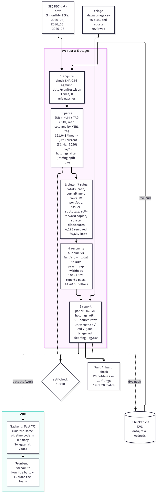
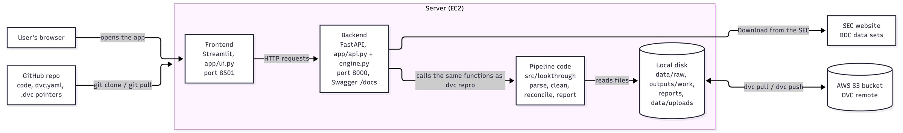

summary: Reproducible pipeline that turns the SEC's 2026q2 BDC data sets into a reconciled, traceable holdings panel (DAMG 7245 Case Study 2B, Team 2)
id: lantern-case-study-2b
categories: Data Engineering
environments: Web
status: Published
feedback link: https://github.com/BigDataIA-Fall-26-Team-2/DAMG-7245-Project-Lantern-Case-Study-2B-Team-2/issues
authors: Dhruvi, Lokesh, Guna, Shravya

# Project LANTERN: A Reconciled BDC Holdings Panel

## Overview

Project LANTERN Case Study 2B turns the SEC's raw BDC (business development company) data sets for 2026q2 into one reconciled holdings panel: every holding of every admitted filing, traceable to its filing and SOI rows, reconciled to the BDC's own reported total within 1%, and honest about what it covers. The whole pipeline rebuilds with one command (`dvc pull && dvc repro`). Built by Team 2 (Dhruvi, Lokesh, Guna, Shravya) for DAMG 7245, Fall 2026.

**Result:** 101 of 177 filings admitted (57.1%), $240.9B of $542.2B filed fair value (44.4%).

**Demo video:** [https://northeastern-my.sharepoint.com/:v:/g/personal/nandavarapu_s_northeastern_edu/IQDoLqRrU-O5TbBlqIM2Quu1AVrjPK7rUj4L4R1mAxP5JJo](https://northeastern-my.sharepoint.com/:v:/g/personal/nandavarapu_s_northeastern_edu/IQDoLqRrU-O5TbBlqIM2Quu1AVrjPK7rUj4L4R1mAxP5JJo)

**What you'll learn**

- Download three monthly SEC BDC data sets with provenance and combine them into one quarter
- Map raw SOI columns to canonical fields by XBRL tag, and split current from comparative schedules
- Clean the artifacts that make the naive sum wrong: totals, cash lines, joint-venture portfolios, subtotals and repeated copies
- Reconcile each filing to its filed total and report coverage and triage honestly
- Verify the panel against the filings, and measure the pipeline's speed and cost

**The pipeline**

acquire -> parse -> clean -> reconcile -> report

*The pipeline: five DVC stages, with numbers from the final run*

Each step of this Codelab covers one Part of the case study, with the command to run it, the key results, and what broke along the way.

**Repository**

[https://github.com/BigDataIA-Fall-26-Team-2/DAMG-7245-Project-Lantern-Case-Study-2B-Team-2](https://github.com/BigDataIA-Fall-26-Team-2/DAMG-7245-Project-Lantern-Case-Study-2B-Team-2)

## Part 0: Setup, acquisition and provenance

Goal: get the three monthly SEC files for our quarter, prove exactly which bytes we used, and store them so anyone can get the same files back with one command.

### Step 0.1: Point the project at our quarter

Our team got 2026q2. In 2026 the SEC publishes one ZIP per month, so our quarter is three files: 2026_04, 2026_05 and 2026_06. In `params.yaml` we list all three under `releases`, set our name and email as the SEC user agent (the SEC refuses downloads without one), and set `use_fixture` to false so everything runs on real data, not the practice fixture.

### Step 0.2: Download the three files and record their fingerprints

`python tools/download_release.py`

This downloads each ZIP from the SEC, unpacks it into its own folder (`data/raw/2026_04_bdc` and so on), and writes `data/manifest.json`. For every ZIP the manifest keeps the URL, the size and a SHA-256 fingerprint. If even one byte of a file changes, its fingerprint changes, so the manifest proves which version of the SEC files we used. The SEC does refresh old releases, so this matters.

You should get three ZIPs: 2026_04 is 1.1 MB, 2026_05 is 41.0 MB and 2026_06 is only 0.1 MB. June is that small because almost every fund files its 31 March report by mid-May, so June holds no reports with a schedule of investments.

### Step 0.3: Track the data with DVC

`dvc add data/raw`

`dvc push`

The data is 664 MB, too big for GitHub, so DVC keeps it in our S3 bucket (lantern-team2-dvc-fall-2026, folder cs2b). GitHub only keeps the small pointer file `data/raw.dvc`. DVC lives inside cs2b, so the case study has its own setup and remote.

### Step 0.4: Prove a fresh clone gets the same files

`git clone <repo> && cd cs2b`

`dvc pull`

`python -c "import sys; sys.path.insert(0,'src'); from lookthrough import acquire; print(acquire.verify_manifest('data/manifest.json', root='.'))"`

In an empty folder, `dvc pull` brought back all 33 files, and `verify_manifest` printed `[]`, which means no file differs from its fingerprint. In the pipeline the acquire stage runs this same check every time, so `dvc repro` stops if the raw files are not the ones in the manifest.

**What broke and how we fixed it**

The starter notebook records only one release in the manifest, and every run overwrote the file. With three monthly files we would have kept only the last one. We wrote one download script that handles all three releases and writes a single manifest with one entry per file.

On Windows the manifest saved paths with backslashes, so a clone on Mac or Linux could not verify them. We changed the manifest to always store forward slashes, and the kit's portability test passes.

Three of the kit's checker tests failed as soon as we switched to real data. They copy our `params.yaml` into a temporary folder that only contains the fixture, so with `use_fixture` false they looked for real data that was not there. The test now sets `use_fixture` to true in its own temporary copy, and our real settings stay untouched.

The first `dvc push` failed with 403 Forbidden even with valid AWS keys. We tested the keys directly and they could list, write and delete in the bucket, so the problem was DVC. The setting `allow_anonymous_login` made DVC connect anonymously and ignore the keys. We switched it off in each teammate's local config, and the push worked.

The bucket is private, so a clone with no AWS login cannot pull. The reproduction is shown from the team's configured environment.

Evidence: `params.yaml`, `data/manifest.json`, `data/raw.dvc`, `.dvc/config`, `tools/download_release.py`, `scripts/acquire.py`, `reports/manifest_check.json`.

## Part 1: Raw parsing and schema mapping

Goal: Turn the raw SOI columns of all three monthly files into one clean, named table of holdings, mapped by XBRL tag, with every row traceable to its source.

### Step 1.1: Load the three monthly files as one quarter

`python scripts/parse.py` (or `dvc repro -s parse`)

The starter code reads one release at a time, so `src/lookthrough/combine.py` loads 2026_04, 2026_05 and 2026_06 together and adds a `release` column. `soi_row` restarts at 0 in each month, so every row is cited as `release` + `soi_row`. You should get 183 filings (4 in April, 179 in May, 0 in June), none flagged as amended.

### Step 1.2: Map columns by tag, not by label

`mapping.map_soi_columns` finds the SOI columns whose labels belong to each canonical tag in the TAG table: fair value, cost, principal, rates, maturity, percent of net assets, identifier, type, industry, affiliation, and `subsidiary` for joint ventures. The full mapping, and a decision for every unmapped column, is in `docs/schema.md`.

### Step 1.3: Split current from comparative rows

`split_periods` marks a row current when its date equals the filing's period end. Of 191,043 rows, 96,373 are current; the rest are last year's comparative schedule, which would roughly double every total. Per-filing counts are in `reports/period_split.csv`.

### Step 1.4: Coalesce holdings and count conflicts

`coalesce_holdings` merges the rows of each holding into one, keeping `source_rows`. You should get 64,762 current holdings, 268 of them with a conflicting value across rows, resolved by keeping the first non-empty value in SOI row order.

### Step 1.5: Check the parsing against the filings

We compared three filings with their printed schedules (`reports/agreement.md`). TCW Steel City matches to the dollar. Oaktree is 19.8% over until its joint-venture portfolios are excluded, then 0.98%. TCW Direct Lending VII matches exactly once its affiliated-investments footnote ($107,862,000) is excluded. No difference came from parsing.

**What broke and how we fixed it**

April had no fair values: April's own TAG table only knows the old label, so per-month mapping read an empty column (0 of 4,378 rows). In the us-gaap/2026 taxonomy the fair-value tag is labelled "Initial fair value of Investment". Merging the TAG tables of all three months fixed it: 4,177 rows.

Joint-venture loans looked like conflicts: 24 filings also list their joint ventures' portfolios, so the same loan held by two JVs was merged and one value thrown away. Adding the JV name (`subsidiary`) to the holding key cut fair-value conflicts from 200 to 2.

Dropped rows with names: 4,032 current rows have an issuer name but no identifier and are dropped; we flagged this in `docs/schema.md` but did not measure its effect on coverage.

Evidence: `src/lookthrough/combine.py`, `src/lookthrough/holdings.py`, `docs/schema.md`, `reports/agreement.md`, `reports/period_split.csv`, `docs/ai_engineering_log_shravya.md`.

## Part 2: Cleaning the extract

Goal: Remove the rows that are not the BDC's own holdings, so that each filing's holdings add up to the fair-value total it reports. Every rule needs a named artifact, an example row from the raw files, a test, and measured evidence that it helps without harming any filing.

### Step 2.1: Measure what each rule does

`PYTHONPATH=src python tools/rule_impact.py`

This runs the whole quarter with all rules, and again with each rule left out. It writes `reports/rule_impact.csv`, with each filing's gap with and without each rule, and `reports/cleaning_log.csv`. A rule was kept only if it admitted filings and pushed no filing further from its total.

### Step 2.2: The seven rules

The rules run in this order (`clean.RULES`, listed in `params.yaml`). Each rule sees only the rows that earlier rules kept. Six come from Part 2; the first, rule_source_disclosures, was added in Part 3 from source-verified filing evidence.

| Rule | Artifact | Rows dropped | Example |
| :---- | :---- | :---- | :---- |
| rule_source_disclosures | Source-verified cash disclosures and repeated investment facts (Part 3, curated evidence) | 4 | 0001193125-26-222738, 2026_05 SOI row 50464 |
| rule_totals | Total and subtotal lines | 29 | TriplePoint Venture Growth −2.85% → 0.00% |
| rule_cash | Cash lines, except money-market lines the filer labels as short-term investments | 36 | Palmer Square −2.02% → 0.000%; Great Elm −3.47% → 0.000% |
| rule_commitment_rows | Rows from the unfunded-commitments table | 2,357 (11 filings) | T Series, 2026_05 SOI row 97935; North Haven A −0.20% → 0.000% |
| rule_jv_portfolio | Loans of unconsolidated joint ventures (Nonconsolidated Subsidiary Axis) | 1,014 | Bain Capital Specialty Finance +93.5% → 0.000% |
| rule_issuer_subtotals | Company lines equal to the sum of their own instruments | 133 | Ares Capital: Ivy Hill $2,661.2M = $1,899.0M + $762.2M; +16.59% → +0.11% |
| rule_rollforward_copies | Affiliate roll-forward repeats of schedule holdings | 319 (20 filings) | FS KKR, Wittur: schedule row 171216 vs copy row 171222; Main Street +12.82% → −0.04% |

### Step 2.3: Coverage as each rule is added

| Rules applied | Admitted (of 177) | Share of filed dollars |
| :---- | :---- | :---- |
| rule_totals | 74 | 23.6% |
| + rule_cash | 75 | 26.1% |
| + rule_commitment_rows | 75 | 26.1% |
| + rule_jv_portfolio | 80 | 28.2% |
| + rule_issuer_subtotals | 85 | 40.2% |
| + rule_rollforward_copies | 90 | 43.5% |
| + rule_source_disclosures and verified-holdings recovery (Part 3) | 101 | 44.4% |

The starter kit (`rule_totals` and `rule_cash` only) admitted 73 filings and 25.8% of dollars. The final pipeline, with all seven rules, admits 101 of 177 filings (57.1%) and 44.4% of dollars.

### Step 2.4: Verify every example against the raw files

`PYTHONPATH=src python tools/verify_examples.py`

This opens each example row in that month's raw `soi.tsv` and confirms that the identifier and value match (`reports/cleaning_log_check.md`). A row is cited as `release` + `soi_row`, which is 0-based; the file line is row + 2.

### Step 2.5: Investigated, no rule

All nine artifacts were investigated. Five did not become rules, because the evidence did not support one:

- Negative values: dropping all negatives harmed 4 filings, because many are schedule lines the filer nets into its total. Only commitment-table rows are dropped, identified by their wording, not their sign.
- Comparative-period rows: 49.6% of rows. These are already handled by `split_periods` in Part 1.
- Equity and warrants: 7,858 holdings are flagged `is_debt = False` but kept, because they are real holdings.
- Holdings without an identifier: 17,278 rows are category totals and are correctly excluded. Five filings (Partners Group, SuRo, Horizon, Firsthand, Equus) have no identified holdings and went to triage.
- Principal currency (from Guna's spot check): principal is in the loan's own currency (GBP, EUR) and the data has no currency column. This is recorded as a known limitation. It does not affect coverage, because reconciliation uses fair value only.

**What broke and how we fixed it**

The starter total rule dropped real borrowers: Total Expert Inc., Total Access Elevator LLC, Total Power Limited and Total Safety Holdings LLC were dropped as "totals". Rows with a company suffix or a maturity date are now kept (42 → 29 rows). This also showed that TriplePoint Private Venture Credit's earlier admission came from wrongly dropping a real $7.5M loan.

The first subtotal rule had 5 false positives, caused by sibling tranches and a loose tolerance. It now uses a tolerance of 0.2% or $1 and excludes tranche names.

Review, round 1 (Lokesh, two findings): in the subtotal rule, ABC was treated as the parent of ABCD LLC; the rule now requires a word boundary after the parent name. In the roll-forward rule, a preferred-equity holding was deleted as a "copy" of a loan with the same value, and a JV loan already dropped by another rule could still act as a counterpart. Now debt never matches equity, each original vouches for only one copy, and each rule sees only surviving rows. Five regression tests fail on the pre-review code (23 of 28 tests pass there) and pass now.

Review, round 2: a revolver was still deleted as a copy of a term loan with the same value. A copy must now carry the roll-forward's own evidence: an opening balance with no cost or principal on the same identifier. 318 of the 324 real copies have it. Debt forms must also agree, so a revolver never matches a term loan.

Guna's spot check found a sampled "holding" that was a commitment-table row. That finding became `rule_commitment_rows`.

Evidence: `src/lookthrough/clean.py`, `docs/cleaning_log.md`, `reports/cleaning_log.csv`, `reports/rule_impact.csv`, `reports/cleaning_log_check.md`, `tests/test_lookthrough.py`, PR #3 and PR #41 review threads, `docs/ai_engineering_log_dhruvi.md`.

## Part 3: Reconciliation, coverage and triage

Goal: Compare each filing's cleaned investments with its independent reported total, publish passing holdings, and explain exclusions with source evidence. Owner: Sai Lokesh Reddy Nandavarapu.

| Step | Input | Output |
| :---- | :---- | :---- |
| Reconcile | Cleaned holdings + reported totals | Comparison results and diagnostics |
| Generate reports | Holdings + comparison results | Admitted holdings panel and coverage reports |
| Triage | Excluded filings + source evidence | Saved explanations and review status |

### Step 3.1: Restore the configured inputs

Run from cs2b with the installed environment. The selected releases are 2026_04, 2026_05 and 2026_06. This configuration selects inputs explicitly; it does not monitor for new SEC releases.

`source .venv/bin/activate`

`AWS_PROFILE=lantern dvc pull`

`dvc repro`

`dvc metrics show`

The acquire stage verifies ZIP sizes and SHA-256 hashes in `data/manifest.json`. DVC also restores the four original HTML snapshots used by source evidence. Profile lantern must refer to an authorized AWS identity. The bucket stays private; the TA accepted demonstrating reproduction from the team's configured environment.

### Step 3.2: Compare the correct values

Inputs: `outputs/work/kept.parquet` from cleaning, plus `num.parquet`, `sub.parquet` and `canon.parquet` from parsing. `reconcile.py` sums current-period holding fair values and compares them with the unique, finite, undimensioned USD `InvestmentOwnedAtFairValue` fact at the SUB period end. Missing or conflicting totals are not guessed or replaced with another tag.

Absolute gap = |holdings sum − filed total| / |filed total|. The tolerance is 0.01. A $15m filed total permits 14.85m–15.15m; $15.5m fails. `rec.parquet` stores arithmetic and admission decisions; `diag.parquet` stores investigation clues.

### Step 3.3: Read the panel and coverage

`report.py` reads retained holdings, reconciliation, diagnostics, cleaning log and SUB, together with `data/triage.csv`. It writes `outputs/panel/holdings.parquet` for admitted filings only, plus `reports/coverage.csv`, `coverage.json`, `coverage.md`, `triage.md` and `cleaning_log.csv`. Each panel row retains `release` and `source_rows`. Annotated rows also retain source fact IDs, document hashes, URLs and precision.

Combined PR #42 snapshot (17ecff2, 2026-10-29, including PR #41): 101/177 attempted filings admitted (57.1%), 76 excluded, and $240,917,454,804 of $542,175,875,908 known filed dollars covered (44.4%). The panel has 34,670 holdings and 38,053 source-row references. Six additional SUB filings have no SOI rows; eight attempts lack a usable filed total. Unknown totals are not estimated as zero dollars.

### Step 3.4: Investigate exclusions and preserve evidence

Edit `data/triage.csv`, not generated `triage.md`. A note records accession, category, source evidence, a row example, fix or reason, review status and reviewed totals. Categories include `totals_counted`, `cash_lines` and `restated_copies`. Use `other` with an explicit unresolved cause when evidence is insufficient. A large gap alone does not prove duplication.

Recovered example: AGL (0001193125-26-214378) summed to $1,278,898,000 against $1,249,444,000 reported. The original filing identifies $29,454,000 as cash outside the investment total. A source-verified rule removes that row and the sum matches exactly.

Still excluded: Blackstone Private Credit Fund (0001803498-26-000031) sums to $88,167,227,000 against $80,469,381,000, a +9.566% gap. No supported correction is established. Missing-value contexts are clues, not proof of the cause. Keep the filing excluded. Its exclusion evidence is reviewed, while its underlying cause remains unresolved.

The source-evidence extension carries curated roles, instrument links and XBRL precision through parsing. It verifies snapshot fingerprints, source contexts and values before guarded cleaning. It recovered AGL, TriplePoint Private Venture, Chicago Atlantic and Prospect Floating Rate, moving admissions from 97 to 101. Three match exactly; Chicago differs by $287. These are generic evidence checks, not issuer-specific branches or target-gap matching. Unannotated future filings remain unchanged.

All 76 current exclusion decisions have reviewed dataset evidence and current totals: 8 no_filed_total, 3 no_identified_holdings, 1 unfunded_commitments and 64 other. The underlying causes of those 64 discrepancies remain unresolved. The notes support keeping them excluded without claiming a proven cleaning fix. The independent audit checked 30,910 retained SOI source-row references and raw NUM totals. Eleven recovered filings’ historical notes are preserved in data/triage_recovered.csv. See reports/triage_review_audit.csv. Changed totals require re-review.

### Step 3.5: Validate and share the artifacts

`python tests/run_tests.py`

`PYTHONPATH=src python -m lookthrough.check`

`python tools/baseline.py`

`python tools/rule_impact.py`

Current validation: 57/57 tests and 10/10 self-checks pass. The checker is unchanged. The separate exclusion audit checked all 30,910 retained source-row references for excluded filings. The earlier mutation experiment caught 25 rule breaks; it was not rerun for this reporting patch. These checks do not mean that every original filing was manually read or every underlying cause was resolved.

After an intentional rule or evidence change, run `dvc repro`, refresh supplementary reports, review differences, then publish with `AWS_PROFILE=lantern dvc push` and commit the lockfile, code and small reports. PR #42's snapshots and rebuilt artifacts are already uploaded; DVC confirmed cache and remote in sync. Computation runs locally; S3 stores artifacts.

**What broke and how we fixed it**

The early baseline used starter rules. Integrating reviewed team rules established 90 admissions; source-supported summary and repeat fixes raised this to 94, 97 and then 101. We kept parsing, cleaning and orchestration separate, rejected ambiguous totals and preserved tranche/context guards. PR #41's commitment rule removes 2,357 candidate rows without changing the final 101 admissions.

Four recoveries needed information absent from SOI labels. We added versioned classification and precision evidence instead of loosening matching. Prospect's repeat is a narrative valuation disclosure, not a roll-forward. Partial missing fair values do not automatically exclude a filing; all-missing values cannot pass. Passing tests never meant that every real-data investigation was complete.

**Evidence and limitations**

Current evidence review and readiness changes: PR #50. Source-backed recoveries were introduced in PR #42. Evidence: data/triage.csv, reports/triage_review_audit.csv, reports/coverage.json, reports/affiliation.md, reports/custom_tag_recovery.md and docs/ai_engineering_log_lokesh.md.Code, reports and documentation are merged into main (PR #50).

The current spot check is 19/20 on the final seven-rule panel. The second-release report uses the earlier five-rule baseline. Economics separates measured laptop runtime from estimated AWS hosting cost. Principal currency and equity units remain limitations. Affiliation has one fully classified category match and 266 incomplete comparisons; custom-tag candidates produced no new admissions.

## Part 4: Verify your dependency

Goal: check single holdings in our panel against the human-readable schedule in each filing, because a filing that adds up to its total can still hide wrong lines.

### Step 4.1: Draw the sample

`python scripts/spot_check_sample.py`

The script takes the 5 largest admitted filings by fair value and 5 more at random, then 2 holdings from each: the largest and one at random. That gives 20 holdings across 10 filings. The random part uses seed 7, so the same panel always gives the same 20 holdings and a grader can draw exactly our sample. It writes `reports/spot_check_sample.csv` with each filing's link, and it never overwrites `reports/spot_check.csv`, where our reviewed results live.

### Step 4.2: Check each holding by hand

For each holding we open the filing, search for the company, and find its line in the schedule dated 31 March 2026. Then we compare two numbers with the panel: fair value and principal. A few things decide which line is the right one. Each 10-Q repeats the December schedule, so we check the date in the table title. When the same loan appears twice, the interest rate in our identifier tells the March line from the December one. When a company has several loans, the loan type and the maturity tell them apart. And we always read the units in the title, because Ares Capital reports in millions, BlackRock and Onex in plain dollars, and most others in thousands.

Each result goes into `reports/spot_check.csv`: the filing's values, yes or no, and a note.

### Step 4.3: Results

19 of 20 holdings match the filing on both fair value and principal.

We checked twice. The first sample was drawn when 90 filings were admitted. After the commitment rule and the triage fixes, 101 filings were admitted and the sample changed, so we drew it again. 11 holdings were the same with the same values and we kept their reviews. The other 9 were new and we checked them by hand. The file reflects the panel we submit.

### Step 4.4: What the checks found

A promise counted as a holding. In the first sample, T Series BDC (2026_05 SOI row 97935) had a "holding" called Cerity Partners Revolver, Commitment Expiration Date 07/28/2031, with no fair value and no principal. In the filing that line is not in the schedule at all. It is in the unfunded commitments table: money promised but not lent yet. Across the panel 1,788 rows in 9 filings looked like this. Dhruvi turned this finding into `rule_commitment_rows`, which removes these rows (2,357 in 11 filings on the final data). In the second sample that line is gone, and T Series gives a real loan, Smarsh, which matches.

Principal has no currency. Apollo's SPARKLE BIDCO loan (SOI row 77827) shows principal £87,479 thousand and fair value $114,051 thousand. Blackstone's Spectrum Safety loan (SOI row 158717) shows EUR 1,806 thousand against $2,087 thousand. The panel has the right numbers, but no currency column, so anyone reading it takes the principal as dollars. The price then comes out around 130 and 116 instead of about par.

A unit count stored as principal (row 14). Great Elm Capital's CLO Formation JV, LLC is common equity, which owes nothing, so it should have no principal. But Great Elm uses one column called "Par Amount / Quantity": for loans it is the amount owed, for equity it is the number of units. The filing shows 166 units, the fund tagged that number as principal, and the panel stored principal 166 (SOI rows 50077;50078). The fair value, 37,590 thousand, matches. Because principal is filled in, the panel marks this equity as debt, and its price is meaningless. It is not only Great Elm: 574 equity holdings in 43 filings carry a principal, some as unit counts, some as zero, some as share counts on preferred shares. We documented it and left the fair values untouched.

Things that looked wrong but were right. For BlackRock's Bluefin loan and Onex's IMB Midco, the first search hit was the December line with a different rate and value; the March line matched our panel, which shows the current-period split works. Onex's IMB Midco revolver really has a negative fair value of (74,594) on a drawn amount of 255,109, exactly as the filing reports it, on the next page of the schedule. Its two term loans have low reported fair values relative to the raw principal fields. Those ratios must not be treated as reliable prices until currency and units are verified; the app withholds price-based watch lists.

**What broke and how we fixed it**

Search did not work in the SEC's inline viewer for large filings. Opening the plain document link instead made Ctrl+F work.

The first search hit was often the wrong schedule. Every 10-Q carries last December's schedule too, so we learned to check the table title and use the rate in the identifier.

Identifiers that end in a number did not always mean the position. "Series A preferred units 3" at Ares was the third of four lines, but "Smarsh ... Two" at T Series was the third of three. The values always pointed to exactly one line, so we matched on the values.

Rerunning the sampler used to overwrite the reviewed file and wipe the hand checks. A reviewer caught it. The sampler now writes a separate file and refuses to touch a file with completed reviews unless told to.

Evidence: `scripts/spot_check_sample.py`, `reports/spot_check_sample.csv`, `reports/spot_check.csv`, `reports/dependency_check.md`.

## Part 5: Pipeline, tests and economics

Goal: Rebuild the panel and every report with one command, and measure what it costs.

### Step 5.1: Run the pipeline

`dvc pull`

`dvc repro`

`dvc metrics show`

`dvc.yaml chains five core stages: acquire, parse, clean, reconcile and report. Each calls the existing functions in src/lookthrough/ using params.yaml. An additional affiliation stage writes category comparisons without changing admissions. Acquire verifies data/manifest.json; it never downloads or writes data/raw. The tolerance is a parameter and reports/coverage.json is a DVC metric.`

### Step 5.2: Make DVC follow the configuration

Paths come from `params.yaml` through `${...}` templating, including `triage.input`, so DVC watches the same files the scripts read. The pipeline stops with a clear error if `data.use_fixture` is true, and needs an explicit `releases` list even for one release.

### Step 5.3: Check it gives the same answer

The staged pipeline reproduced the team's outputs exactly at the time it was built (five-rule baseline): identical reports, and the same panel row for row (34,755 holdings). A second `dvc repro` skips every stage, and on the same machine forced reruns leave `dvc.lock` unchanged. The final seven-rule panel has 34,670 holdings.

### Step 5.4: Tests that fail

`python tests/run_tests.py`

`python tools/break_rules.py`

Each rule has its own test. The current submission-readiness suite passes 57/57 tests and the unchanged self-check passes 10/10. A passing test only matters if it fails when the code is wrong. `tools/break_rules.py` breaks the rules 25 ways: it removes each rule, then removes each of its safeguards, such as the word boundary, the debt/equity check, the roll-forward evidence and the no-principal guard. It then runs the suite after each break.

In the earlier mutation experiment, all 25 breaks were caught, clean.py was restored byte-identical and the then-current suite passed again. That experiment was not rerun for the latest reporting and affiliation patch. The breaks marked as review findings reproduce exactly the bugs Lokesh found. Full results are in `reports/tests_that_fail.md`.

### Step 5.5: Unit economics

AWS estimate for 730 hours/month: m7i-flex.large in us-east-1 at $0.09576/hour ($69.90), 40 GiB gp3 ($3.20), one Elastic IP ($3.65) and 0.704 GiB of S3 objects (about $0.02): approximately $76.77/month always-on.
Stopping EC2 while retaining the disk and IP costs about $6.87/month. Requests, transfer, taxes and credits are excluded. The earlier 9.7-second run was measured on an Apple M3 Pro (18 GB), not EC2, and excludes the new affiliation stage. Analyst time savings were not measured. Current coverage is 101/177 filings and 44.4% of known filed dollars; the spot check is 19/20. See reports/economics.md for assumptions and pricing sources.

**What broke and how we fixed it**

The download script could not be a stage: it rewrote `data/raw`, which DVC owns, and the manifest with today's date on every run. It moved unchanged to `tools/download_release.py`.

Review found hardcoded paths: DVC watched `data/triage.csv` while the code read `triage.input`, so editing another triage file left the report stale. Templating the paths fixed it, tested with the reviewer's own reproduction.

A stale lock file on main was refreshed with dvc repro and the current artifacts synced with dvc push. Submission safeguards now isolate notebook outputs in scratch locations, include python-multipart for fresh app installations, and use the shared deterministic sampler. These protections help prevent exploratory runs from overwriting submission evidence.

The DVC bucket is private, so a fresh clone needs an authorized AWS profile: `dvc remote modify --local storage profile <name>`, then `dvc pull`. The TA accepted demonstrating reproduction from the team's configured environment.

Evidence: `dvc.yaml`, `dvc.lock`, `scripts/`, `reports/economics.md`, `reports/manifest_check.json`, `reports/tests_that_fail.md`, `docs/ai_engineering_log_shravya.md`.

## The app: frontend, backend and deployment

Goal: let anyone use the panel and see how it is built, without running commands.

*App architecture: Streamlit and FastAPI on EC2, using the same pipeline code and DVC data*

The backend is FastAPI (`app/api.py`, `app/engine.py`). It runs our own pipeline functions from `src/lookthrough` in memory, with the settings the user picks: which months, which cleaning rules and which tolerance. Reading the files is slow, so it happens once and stays in memory, and every later run takes seconds. A run never writes to `outputs/` or `reports/`, so the DVC outputs stay exactly as the pipeline made them. All endpoints are documented in Swagger at `/docs`.

The frontend is Streamlit (`app/ui.py`) and has two modes. "How it's built" walks through the pipeline one step at a time, with the six steps shown as boxes at the top that fill in as you go: source with the fingerprint check, read, clean with a switch for each rule, compare with a tolerance slider and a chart of every filing's gap, the final list, and the hand checks with our values and the filing's values side by side. "Explore the loans" is for daily use: an overview, a search that finds one company across every fund and shows how each fund values it, the fund reports split into the ones that add up and the ones that do not with their triage reason. Price-based watch lists and aggregated principal are withheld because principal currency and equity units are not verified.

Users can also add months by uploading ZIPs or downloading from the SEC. Added files are checked, fingerprinted and saved only in `data/uploads` on that machine.

`uvicorn app.api:app --port 8000`

`streamlit run app/ui.py`

Deployed on EC2: [http://100.49.157.253/](http://100.49.157.253/)

Swagger API docs: [http://100.49.157.253/docs](http://100.49.157.253/docs)

Evidence: `app/api.py`, `app/engine.py`, `app/ui.py`, `app/README.md`.

## Stretch goals

### Second release

`python tools/download_release.py` then `dvc repro`, after setting `release` and `releases` to 2026_08 in `params.yaml`

We ran the pipeline unchanged on 2026_08, using the five-rule baseline. Coverage was 89 of 169 filings (52.7%) and 40.5% of dollars, against 50.8% and 43.5% for 2026q2 under the same rules, so the cleaning rules generalise to a quarter they were not built on. Half of the switches between releases are near-misses at the 1% tolerance. (The final seven-rule 2026q2 result is 57.1% and 44.4%; 2026_08 was not rerun with the final rules.) See `reports/second_release.md`.

### Custom-tag recovery

Goal: recover fair values that filers report under custom or alternative tags, where the standard fair-value column is empty.

The reproducible audit screened 3,488 current-period custom NUM facts across 39 filings. It filled 34 exact candidate matches in a copy of the inputs and reran all seven cleaning rules. Neither TCW filing was re-admitted: the gaps worsened from +16.718% to +112.455% and from +16.616% to +54.147%. Production holdings remain unchanged. The source investigation identifies the matched facts as affiliate roll-forward balances. No verified custom-tag recovery or completed recovery bonus is claimed. See reports/custom_tag_recovery.md and tools/audit_custom_fv.py.

One named exception: Lord Abbett Private Credit Fund S (−5.66%) is short by exactly its JV investment ($21.608M, 2026_05 SOI row 17151), which it reports under the generic Investments tag. A fallback to that tag also picks up a category subtotal (+2.01%), so this filing went to triage instead of getting a rule.

Evidence: `docs/cleaning_log.md` (section "custom/alternative-tag fair values").

### Affiliation reconciliation

An additional DVC stage compares explicit standard SOI affiliation labels with unique current USD NUM category totals. One fully classified category matches exactly ($387,669,000); 266 comparisons remain incomplete because classification or values are missing. Unknown, custom or conflicting membership cannot pass. Overall filing admissions are unchanged. Evidence: reports/affiliation.csv and reports/[affiliation.md](http://affiliation.md).

### Issue draft

reports/issue_draft.md documents five issues: principal currency and equity units (Guna, PR #49), and roll-forward rows, commitment rows and generic-tag fair values (Dhruvi). No external issue has been posted.
